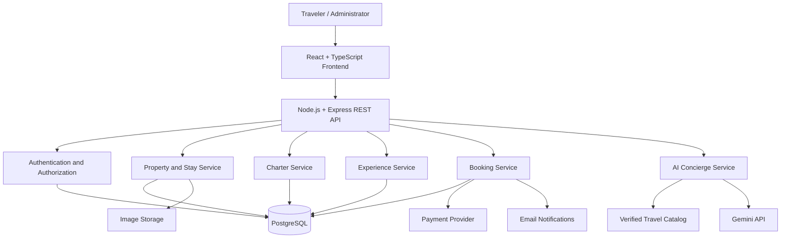

# ✨ LuxeWay 2.0

### Quiet Luxury Stays, Private Charters & Intelligent Travel Experiences

**Discover extraordinary destinations. Curate exceptional journeys. Experience travel differently.**

<div align="center">

[🌐 Live Demo](https://luxeway-nine.vercel.app/) · [💻 GitHub](https://github.com/Mugunthandk) · [👨‍💻 LinkedIn](https://www.linkedin.com/in/mugunthandk/)


</div>

---

## 📖 Table of Contents

- [Overview](#-overview)
- [Vision and Objectives](#-vision-and-objectives)
- [Platform Features](#-platform-features)
- [AI Travel Concierge](#-ai-travel-concierge)
- [Technology Stack](#-technology-stack)
- [System Architecture](#-system-architecture)
- [Project Structure](#-project-structure)
- [Getting Started](#-getting-started)
- [Environment Configuration](#-environment-configuration)
- [Proposed API Architecture](#-proposed-api-architecture)
- [Database Design](#-database-design)
- [Security and Reliability](#-security-and-reliability)
- [Testing and Quality Assurance](#-testing-and-quality-assurance)
- [Deployment](#-deployment)
- [Development Roadmap](#-development-roadmap)
- [Contributing](#-contributing)
- [Developer](#-developer)
- [License](#-license)

---

## 🌍 Overview

**LuxeWay** is a luxury travel discovery platform designed around the concept of quiet luxury, personalized service, and exceptional experiences.

The platform brings together premium stays, private transportation, curated destinations, fine dining, wellness retreats, and exclusive activities in an elegant digital experience.

LuxeWay focuses on making luxury travel discovery visual, intuitive, and inspiring while establishing a foundation for personalized trip planning and future booking capabilities.

### The LuxeWay Experience

- 🏨 Discover luxury hotels, villas, resorts, and private residences.
- ✈️ Explore private aviation and premium transportation.
- 🛥️ Discover yacht charters and exclusive marine experiences.
- 🌍 Browse destinations and curated travel collections.
- 🍽️ Explore fine dining and premium culinary experiences.
- 🧘 Discover wellness retreats and leisure activities.
- 🗺️ Plan personalized multi-day itineraries.
- 🤖 Explore AI-assisted travel planning as the platform evolves.

**Live Website:** https://luxeway-nine.vercel.app/

---

## 🎯 Vision and Objectives

The long-term vision is to evolve LuxeWay from a luxury travel discovery interface into a comprehensive travel technology platform.

### Core objectives

1. Deliver a premium, responsive user experience.
2. Organize luxury travel options through intuitive discovery and filtering.
3. Make travel planning more personalized and convenient.
4. Introduce an AI travel concierge grounded in real catalog data.
5. Develop a secure booking, payment, and reservation workflow.
6. Provide tools for managing properties, charters, experiences, and bookings.
7. Build a scalable architecture suitable for future integrations.

---

## ✨ Platform Features

### 🏠 1. Luxury Homepage

- Editorial-style hero section.
- Immersive destination imagery.
- Curated property collections.
- Featured destinations and experiences.
- Premium charter discovery.
- Carefully designed calls to action.
- Responsive navigation and layouts.
- Elegant typography and generous whitespace.

### 🏨 2. Luxury Stays

Discover a curated range of accommodation categories:

- Luxury hotels.
- Private villas.
- Beachfront resorts.
- Boutique properties.
- Private residences.
- Mountain retreats.

The planned property experience can include:

- Property galleries and descriptions.
- Location and nearby attractions.
- Room types and guest capacity.
- Amenities and property policies.
- Nightly pricing and additional charges.
- Availability calendars.
- Guest reviews and ratings.

Live inventory and bookable availability require a connected property data source or reservation backend.

### ✈️ 3. Private Charters

Explore premium transportation categories:

- Private jets.
- Yacht charters.
- Helicopter transfers.
- Luxury cars.
- Chauffeur services.

Planned charter details include passenger capacity, departure and arrival locations, duration, estimated pricing, and availability.

### 🌍 4. Curated Destinations

Discover destinations through themed collections.

**Featured destinations:**

- Dubai
- Maldives
- Bali
- Paris
- Switzerland
- London
- Singapore

Future destination pages can include local highlights, seasonal travel guidance, recommended stays, experiences, and suggested itineraries.

### ✨ 5. Exclusive Experiences

Explore experiences organized by category:

- Fine dining.
- Private yacht tours.
- Desert adventures.
- Wellness retreats.
- Cultural experiences.
- Adventure activities.
- Luxury shopping.
- Private guided tours.

The planned experience detail page can present duration, location, pricing, inclusions, restrictions, and booking requirements.

### ❤️ 6. Personalized Discovery

Planned personalization features:

- Saved properties and experiences.
- Recently viewed destinations.
- Preference-based discovery.
- Budget-aware recommendations.
- Travel-style preferences.
- Personalized destination collections.

### 📱 7. Responsive Experience

- Desktop, tablet, and mobile layouts.
- Touch-friendly navigation.
- Responsive image galleries.
- Clear form validation.
- Accessible interactive elements.
- Loading, error, and empty states.
- Performance-conscious image handling.

---

## 🤖 AI Travel Concierge

The AI Travel Concierge is a planned extension that can help travelers turn their preferences into structured travel plans.

### Example interaction

**Traveler:**

"Plan a five-day luxury trip to the Maldives with an overwater villa, private transfers, wellness experiences, and a budget of ₹3,00,000 for two people."

**Potential concierge response:**

- Suggested destinations and accommodation options.
- A day-by-day itinerary.
- Recommended activities and dining experiences.
- Estimated costs and budget allocation.
- Optional transportation and transfer suggestions.
- Links to matching properties and experiences.

### Proposed AI workflow

1. Collect travel dates, destination preferences, group size, and budget.
2. Retrieve matching records from the verified travel catalog.
3. Provide relevant catalog information to the AI service.
4. Generate a structured itinerary.
5. Validate property and experience identifiers.
6. Calculate estimates using trusted pricing data.
7. Present the itinerary for customer review and editing.

### AI engineering principles

- Keep API credentials on the server.
- Use real catalog records to ground recommendations.
- Treat generated prices and availability as unverified until checked against authoritative data.
- Distinguish estimates from confirmed quotes.
- Allow travelers to edit generated itineraries.
- Handle API failures and rate limits gracefully.
- Avoid sending unnecessary personal information to external AI services.

**Implementation status:** AI capabilities are part of the proposed roadmap unless the corresponding integration is already present in the codebase.

---

## 🛠️ Technology Stack

### Current frontend foundation

| Technology | Purpose |
|---|---|
| React | Component-based user interface |
| TypeScript | Type safety and maintainability |
| Vite | Development server and production builds |
| Tailwind CSS | Responsive styling |
| HTML5 and CSS3 | Web structure and presentation |
| Vercel | Frontend deployment |

### Proposed full-stack extensions

| Technology | Purpose |
|---|---|
| Node.js | Backend runtime |
| Express.js | REST API and business logic |
| PostgreSQL | Structured travel and booking data |
| Prisma | Database access and schema migrations |
| Secure sessions or JWT | Authentication |
| Google OAuth | Optional social sign-in |
| Gemini API | AI travel concierge |
| Mapbox or Google Maps | Destination and map interfaces |
| Cloudinary | Image management |
| Razorpay or Stripe | Payment processing |
| Resend | Transactional email |
| Vitest | Unit and component testing |
| Playwright | End-to-end testing |

The proposed extensions should be included in the implemented-stack section only after they have been added and verified.

---

## 🏗️ System Architecture

The following diagram illustrates the proposed full-stack architecture.



### Architecture principles

- Keep UI components separate from business logic.
- Centralize data access through a backend API.
- Validate all incoming requests.
- Enforce permissions on the server.
- Keep pricing and availability calculations on trusted services.
- Use payment webhooks and idempotent processing.
- Make external integrations replaceable where practical.

---

## 📂 Project Structure

### Frontend structure

```text
LuxeWay/
├── public/
│   ├── images/
│   └── favicon.svg
├── src/
│   ├── assets/
│   ├── components/
│   │   ├── common/
│   │   ├── layout/
│   │   ├── stays/
│   │   ├── charters/
│   │   ├── destinations/
│   │   └── experiences/
│   ├── pages/
│   ├── hooks/
│   ├── services/
│   ├── types/
│   ├── utils/
│   ├── data/
│   ├── styles/
│   ├── App.tsx
│   └── main.tsx
├── tests/
├── package.json
├── vite.config.ts
├── tsconfig.json
└── README.md
```

Adapt this example to match the existing repository. Actual filenames and directories may differ.

### Proposed backend structure

```text
server/
├── src/
│   ├── config/
│   ├── middleware/
│   ├── modules/
│   │   ├── auth/
│   │   ├── users/
│   │   ├── stays/
│   │   ├── charters/
│   │   ├── experiences/
│   │   ├── destinations/
│   │   ├── bookings/
│   │   ├── payments/
│   │   └── concierge/
│   ├── services/
│   ├── validators/
│   ├── utils/
│   ├── app.ts
│   └── server.ts
├── tests/
├── package.json
└── .env.example
```

---

## ⚙️ Getting Started

### Prerequisites

- Node.js compatible with the project's Vite version.
- npm.
- Git.
- Visual Studio Code or another code editor.

The backend and third-party accounts are required only when those integrations are implemented.

### 1. Clone the repository

```bash
git clone https://github.com/Mugunthandk/LuxeWay.git
cd LuxeWay
```

Confirm that the repository URL and capitalization match your actual GitHub repository.

### 2. Install dependencies

```bash
npm install
```

### 3. Start the development server

```bash
npm run dev
```

### 4. Open the local application

Vite typically serves the development application at:

```text
http://localhost:5173
```

Use the actual URL shown in your terminal if a different port is selected.

### 5. Create a production build

```bash
npm run build
```

### 6. Preview the production build

```bash
npm run preview
```

Check `package.json` for the scripts available in the existing project before running them.

---

## 🔐 Environment Configuration

A frontend-only application may not require a server-side `.env` file.

For the proposed full-stack architecture, configure environment variables on the backend.

Example `.env.example`:

```env
NODE_ENV=development
PORT=5000

DATABASE_URL=your_database_connection_string

SESSION_SECRET=your_long_random_secret

GEMINI_API_KEY=your_gemini_api_key

CLOUDINARY_CLOUD_NAME=your_cloud_name
CLOUDINARY_API_KEY=your_cloudinary_api_key
CLOUDINARY_API_SECRET=your_cloudinary_api_secret

PAYMENT_PROVIDER_KEY=your_test_key
PAYMENT_PROVIDER_SECRET=your_test_secret

CLIENT_URL=http://localhost:5173

EMAIL_API_KEY=your_email_provider_api_key
```

These are illustrative placeholders, not a guarantee that the current project reads these variables.

### Environment security

- Keep secrets outside source control.
- Add `.env` files to `.gitignore`.
- Store private API keys only on the server.
- Use separate development and production credentials.
- Configure production secrets through the hosting provider.
- Never expose payment secrets or database credentials to browser code.

---

## 🔌 Proposed REST API Architecture

The following endpoints describe the intended full-stack design.

| Method | Endpoint | Purpose |
|---|---|---|
| GET | `/api/destinations` | Browse destinations |
| GET | `/api/stays` | Search accommodation |
| GET | `/api/stays/:id` | Retrieve property details |
| GET | `/api/charters` | Browse private charters |
| GET | `/api/experiences` | Browse curated experiences |
| POST | `/api/auth/register` | Register an account |
| POST | `/api/auth/login` | Authenticate a traveler |
| GET | `/api/users/me` | Retrieve the current profile |
| GET | `/api/bookings` | Retrieve authorized bookings |
| POST | `/api/bookings` | Create a booking request |
| GET | `/api/bookings/:id` | Retrieve booking details |
| POST | `/api/concierge/itinerary` | Generate an AI itinerary |
| POST | `/api/payments/verify` | Verify a payment |
| GET | `/api/admin/analytics` | Retrieve authorized analytics |

These endpoints are proposed interfaces. They should be documented as implemented APIs only after the corresponding routes exist.

---

## 🗄️ Database Design

PostgreSQL is the recommended primary database for the proposed booking platform because it supports relational records and transaction-based workflows.

### Proposed entities

| Entity | Example fields |
|---|---|
| Users | id, name, email, role |
| Destinations | id, name, country, description |
| Properties | id, destination_id, name, address |
| Room Types | id, property_id, capacity, base_price |
| Availability | id, room_type_id, date, inventory |
| Charters | id, type, departure_location, capacity |
| Experiences | id, destination_id, name, duration |
| Bookings | id, user_id, status, total_amount |
| Booking Items | id, booking_id, item_type, item_id |
| Payments | id, booking_id, provider_reference, status |
| Reviews | id, user_id, item_id, rating |
| Itineraries | id, user_id, destination_id, travel_dates |

### Data integrity and booking reliability

- Store currency amounts using appropriate decimal or integer minor-unit representations.
- Validate dates, capacity, and availability on the server.
- Recheck availability before confirming a reservation.
- Prevent conflicting reservations using transactions and appropriate database constraints.
- Calculate totals using trusted server-side pricing.
- Maintain explicit booking and payment states.
- Avoid storing raw card details.
- Record necessary booking changes for operational auditing.

---

## 🛡️ Security and Reliability

The full-stack implementation should include:

- Server-side request validation.
- Secure password hashing or a trusted authentication provider.
- Role-based access control for administrative operations.
- Rate limiting for authentication and sensitive endpoints.
- Secure session or token handling.
- Restricted CORS configuration.
- Protection against injection and common web vulnerabilities.
- Payment signature and webhook verification.
- Idempotent payment and booking processing.
- Safe handling of external API failures.
- Appropriate logging without leaking secrets.
- Privacy-conscious handling of customer and travel information.

A booking must not be marked as paid merely because the browser reports a successful checkout. The backend must verify the payment with the relevant provider.

---

## 🧪 Testing and Quality Assurance

Recommended testing strategy:

### Unit and component tests

Use Vitest and React Testing Library to test components, input validation, and application logic.

```bash
npm run test
```

### End-to-end tests

Use Playwright to validate essential customer workflows.

```bash
npx playwright test
```

These commands require the corresponding dependencies and scripts to be configured.

### Important test scenarios

- Destination search and filtering.
- Property detail navigation.
- Date and guest selection.
- Invalid or unavailable booking requests.
- Itinerary creation and editing.
- Authentication and access control.
- Payment failure and webhook handling.
- Prevention of duplicate bookings.
- Responsive layouts and accessibility.
- API timeout and error handling.

---

## 🚀 Deployment

### Frontend deployment with Vercel

1. Push the project to GitHub.
2. Import the repository into Vercel.
3. Configure the frontend root directory.
4. Set the correct build command.
5. Configure the output directory, usually `dist` for Vite.
6. Add any required public environment variables.
7. Deploy and verify the production website.

**Live website:** https://luxeway-nine.vercel.app/

### Backend deployment with Render

When the backend is implemented:

1. Create a Render web service.
2. Configure the backend build and start commands.
3. Add the required environment variables.
4. Configure secure database connectivity.
5. Set allowed frontend origins.
6. Verify API health, logs, and error responses.
7. Test booking and payment workflows before production use.

### Production checklist

- [ ] Production build succeeds.
- [ ] Environment variables are configured.
- [ ] No secrets are exposed in client code.
- [ ] Database migrations have been applied.
- [ ] API permissions have been tested.
- [ ] Booking availability and pricing are verified server-side.
- [ ] Payment verification has been tested.
- [ ] Mobile layouts and accessibility have been reviewed.
- [ ] Error monitoring and backup procedures are configured.

---

## 🗺️ Development Roadmap

### Phase 1: Premium Travel Discovery

- [x] Initial LuxeWay frontend.
- [x] Luxury travel positioning and visual foundation.
- [ ] Complete destination discovery.
- [ ] Detailed property and experience pages.
- [ ] Advanced search and filtering.
- [ ] Saved properties and experiences.

### Phase 2: Full-Stack Foundation

- [ ] Express backend.
- [ ] PostgreSQL database and migrations.
- [ ] Authentication and user profiles.
- [ ] Destination and property APIs.
- [ ] Admin access control.

### Phase 3: Booking Platform

- [ ] Availability and pricing services.
- [ ] Booking requests and confirmation.
- [ ] Reservation management.
- [ ] Payment gateway integration.
- [ ] Email notifications and cancellation workflows.

### Phase 4: AI and Personalization

- [ ] AI Travel Concierge.
- [ ] Personalized destination recommendations.
- [ ] Multi-day itinerary generation.
- [ ] Budget-aware trip planning.
- [ ] Interactive maps and route visualization.

### Phase 5: Production Readiness

- [ ] Automated test coverage.
- [ ] Performance optimization.
- [ ] Security review.
- [ ] Monitoring and error reporting.
- [ ] Production booking verification.
- [ ] Deployment documentation.

Update the checkboxes as features are implemented and tested. A planned capability should not be marked complete solely because its UI or design has been created.

---

## 🤝 Contributing

Contributions and suggestions are welcome.

1. Fork the repository.
2. Create a feature branch.

   ```bash
   git checkout -b feature/your-feature
   ```

3. Implement and test your changes.
4. Commit your changes.

   ```bash
   git commit -m "feat: describe your change"
   ```

5. Push the branch.

   ```bash
   git push origin feature/your-feature
   ```

6. Open a pull request with a clear description of the changes.

---

## 👨‍💻 Developer

### Mugunthan DK

**Full Stack Developer | AI/ML Enthusiast**

B.Tech Information Technology, VSB Engineering College

- **Portfolio:** https://mugunthandk-portfolio-vvuy.vercel.app/
- **GitHub:** https://github.com/Mugunthandk
- **LinkedIn:** https://www.linkedin.com/in/mugunthandk/
- **LuxeWay Live Demo:** https://luxeway-nine.vercel.app/

Interested in building modern web applications, AI-powered products, and reliable software solutions.

---

## 📄 License

No license has been specified in this README. Add an appropriate `LICENSE` file before presenting the repository as an open-source project with defined reuse permissions.

---

<div align="center">

### ✨ LuxeWay

**Travel beautifully. Stay exceptionally. Experience more.**

Built with ❤️ by **Mugunthan DK**

[Explore LuxeWay](https://luxeway-nine.vercel.app/) · [Connect on LinkedIn](https://www.linkedin.com/in/mugunthandk/)

</div>
